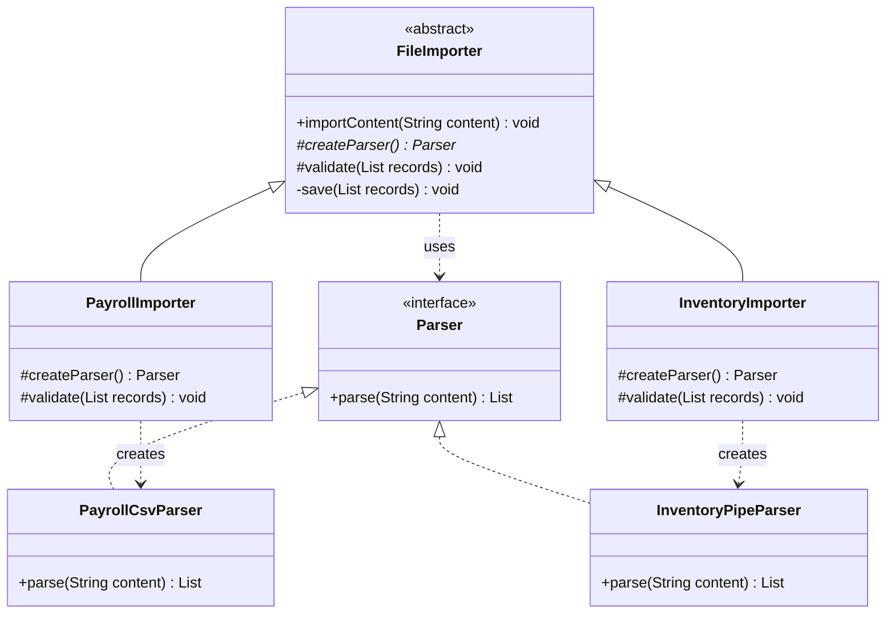

# 1. Subclasses already exist and each needs its own helper object

## Use case
A backend imports payroll files and inventory files. Every import runs the same
steps: **parse -> validate -> save**. The file format and validation rules differ.

## Who does what
| Role | Class |
|---|---|
| Creator | `FileImporter` |
| Factory method | `createParser()` |
| Concrete creators | `PayrollImporter`, `InventoryImporter` |
| Product | `Parser` |
| Concrete products | `PayrollCsvParser`, `InventoryPipeParser` |

## Class diagram


## Why Factory Method fits
- The subclasses have a reason to exist besides creating a parser: each has its
  own validation rules.
- Choosing `PayrollImporter` already decides the parser. A separate
  `ParserFactory` would have to make the same choice a second time.

`validate()` is an ordinary overridable step (Template Method).
`createParser()` is the factory method because it decides which object is created.

## When not to use it
If the importers differed **only** in their parser, keep one `FileImporter` and
pass the `Parser` into its constructor.

Something still has to choose the importer (here, `Main` does it directly).

## Run (from `src`)
```bash
javac -d /tmp/out factoryMethodExamples/existingSubclasses/*.java
java -cp /tmp/out factoryMethodExamples.existingSubclasses.Main
```
