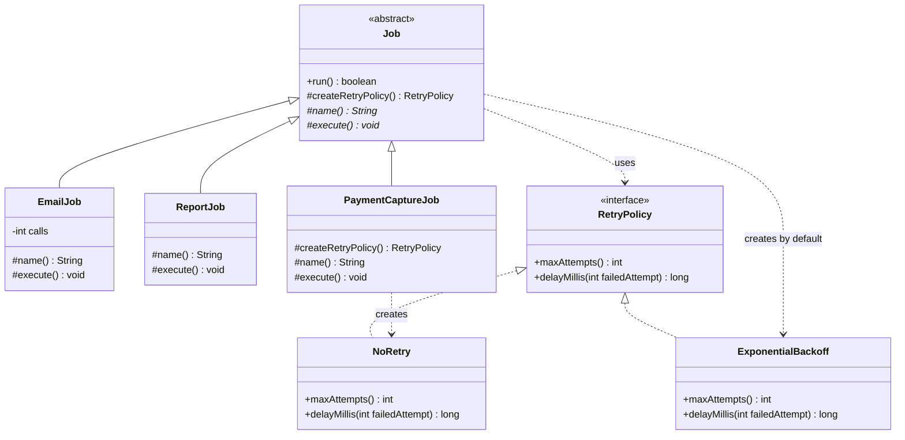

# 3. A default that some subclasses replace

## Use case
Background jobs share one retry loop. Most should retry with exponential
backoff. Payment capture must not retry blindly: after a timeout you don't know
whether the charge went through.

## Who does what
| Role | Class |
|---|---|
| Creator | `Job` |
| Factory method | `createRetryPolicy()` (not abstract) |
| Creators using the default | `EmailJob`, `ReportJob` |
| Creator overriding it | `PaymentCaptureJob` |
| Product | `RetryPolicy` |
| Concrete products | `ExponentialBackoff`, `NoRetry` |

## Class diagram


## Why Factory Method fits
`EmailJob` and `ReportJob` write no code about retries. Only the exception
overrides the method. The jobs already exist as subclasses because each has its
own `execute()`.

## When not to use it
If the retry policy comes from configuration, or must be mixed freely across
jobs, pass it into the constructor.

Real payment systems often make retries safe with idempotency keys.

## Run (from `src`)
```bash
javac -d /tmp/out factoryMethodExamples/overridableDefault/*.java
java -cp /tmp/out factoryMethodExamples.overridableDefault.Main
```
