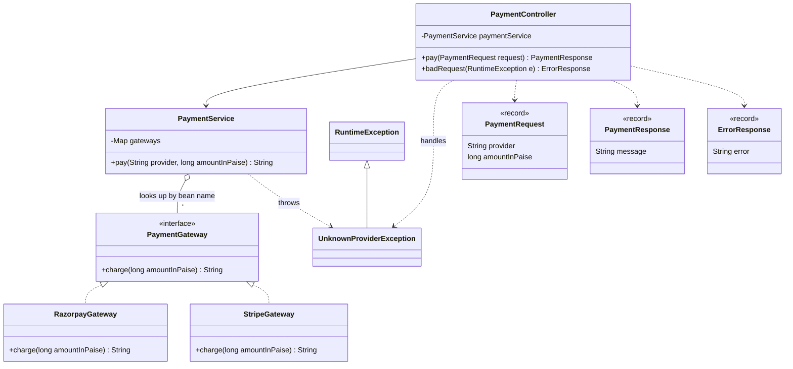

# Simulated real backend with Spring Boot

## Use case
`POST /payments` receives the provider name at runtime and must send the payment
to the matching gateway.

## Which pattern is this?
**It is not Factory Method.** No subclass overrides a creation method. It is
dependency injection plus a lookup by key, which selects a strategy. It does the
selection job of a simple factory, except that Spring creates the objects and
`PaymentService` only picks one.

## Flow
```
PaymentController -> PaymentService -> Map<String, PaymentGateway>
                                          "razorpay" -> RazorpayGateway
                                          "stripe"   -> StripeGateway
```
Spring injects every `PaymentGateway` bean into the map, keyed by bean name.

## Class diagram


## Adding a gateway
Add one class. The service and controller don't change:
```java
@Component("paypal")
public class PaypalGateway implements PaymentGateway { ... }
```
It must be in a package that component scanning covers.

## Things to know
- Gateway beans are singletons shared by all requests, so keep them free of
  per-request state.
- If you need a **new** object for each request, a map of beans is not enough.
  Inject a factory, or an `ObjectProvider` for a prototype bean.
- Bean names become part of your API. In a larger app, have each gateway declare
  its own key (such as an enum from `provider()`) and build the map from a
  `List<PaymentGateway>`.
- This is a simulation: no real charges, authentication or idempotency.

## Run
Needs Java 21 and Maven. Open `pom.xml` in IntelliJ and choose
"Add as Maven Project", or from this folder:
```bash
mvn test
mvn spring-boot:run
```
```bash
curl -X POST http://localhost:8080/payments \
  -H "Content-Type: application/json" \
  -d '{"provider":"razorpay","amountInPaise":500}'
```
