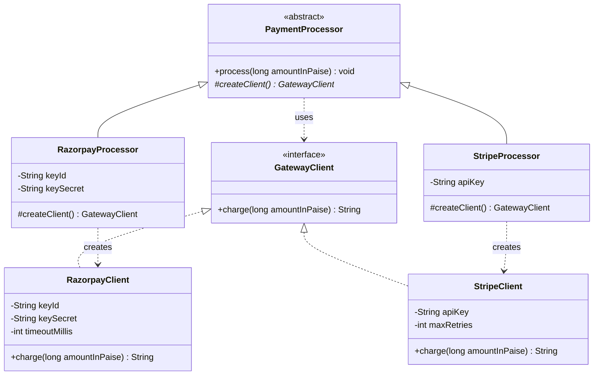

# 2. Creation needs the subclass's own data or setup

## Use case
Every payment follows the same steps: **check amount -> charge -> audit log**.
Each gateway client is built differently: Razorpay needs a key id, secret and
timeout; Stripe needs an API key and retry count.

## Who does what
| Role | Class |
|---|---|
| Creator | `PaymentProcessor` |
| Factory method | `createClient()` |
| Concrete creators | `RazorpayProcessor`, `StripeProcessor` |
| Product | `GatewayClient` |
| Concrete products | `RazorpayClient`, `StripeClient` |

## Class diagram


## Why Factory Method fits
A central `createClient(type, ...)` would need the settings of every gateway:
a long parameter list or a shared config object. Here each processor keeps its
own settings, and the parent never sees them.

## Trade-off
Injecting a ready-built `GatewayClient` into one `PaymentProcessor` class also
works, and is better if the processors have no other differences. These
subclasses are deliberately small; the pattern pays off more when each one also
has gateway-specific behaviour.

`createClient()` builds a new client on every call. Real HTTP or SDK clients are
usually expensive, so you would normally create one once and reuse it.

The clients are simulated and the keys are dummy values. Load real secrets from
configuration or a secret manager.

## Run (from `src`)
```bash
javac -d /tmp/out factoryMethodExamples/subclassSetup/*.java
java -cp /tmp/out factoryMethodExamples.subclassSetup.Main
```
