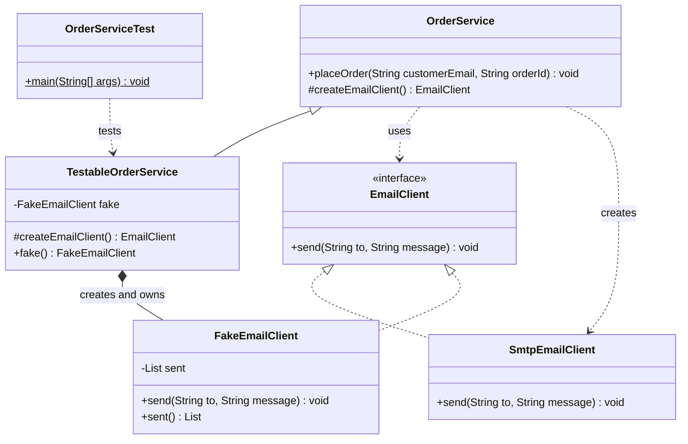

# 4. A seam for substituting objects in tests

## Use case
`OrderService` creates its own email client. A test must check the confirmation
email without contacting a mail server.

## Who does what
| Role | Class |
|---|---|
| Creator | `OrderService` |
| Factory method | `createEmailClient()` |
| Test-only creator | `TestableOrderService` |
| Product | `EmailClient` |
| Concrete products | `SmtpEmailClient`, `FakeEmailClient` |

## Class diagram


## Why it helps
If `placeOrder()` called `new SmtpEmailClient()` directly, a test could not
replace it by ordinary means. Moving the `new` into an overridable method is a
small, low-risk change to legacy code. This technique is often called
"subclass and override factory method".

## Prefer this in new code
```java
public OrderService(EmailClient emailClient) {
    this.emailClient = emailClient;
}
```
The test then passes a `FakeEmailClient` in, with no test subclass, and the
dependency is visible in the constructor.

## Run (from `src`)
```bash
javac -d /tmp/out factoryMethodExamples/testSubstitution/*.java
java -cp /tmp/out factoryMethodExamples.testSubstitution.Main
java -cp /tmp/out factoryMethodExamples.testSubstitution.OrderServiceTest
```
